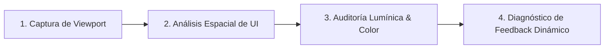

# 👁️ Inspector Visual Multimodal (`/ojos`)

> **Rol**: Auditor Sensorial Visual, Verificador de Viewport y Diagnóstico de Pantalla  
> **Herramientas**: Capturas de pantalla, MCP Vision, Godot Window Introspection  
> **Enfoque**: Detección de desfases visuales, anclajes erróneos, textos superpuestos y fidelidad lumínica.

---

## 🏛️ 1. Misión y Alcance Técnico

La skill **Ojos** proporciona percepción visual directa sobre el estado real de la ventana de Godot en tiempo de ejecución. Elimina la "ceguera espacial" de los modelos de lenguaje: un script puede compilar sin errores lógicos mientras un botón clave queda oculto tras un marco de madera o el texto de una comanda se desborda fuera del monitor. `/ojos` observa, mide y diagnostica visualmente la pantalla para respaldar a [`/disenador_grafico`](file:///C:/Users/curso/.gemini/antigravity/skills/disenador_grafico/SKILL.md) y [`/playtester`](file:///C:/Users/curso/.gemini/antigravity/skills/playtester/SKILL.md).

---

## 🔍 2. Protocolo de Inspección Visual en 4 Pasos

### Paso 1: Captura del Viewport
- Obtención de captura limpia de la ventana de juego (1280x720) en el estado actual.

### Paso 2: Análisis Espacial de UI y Anclajes
- **Alineación de Retratos**: Verificar que retratos como `sergeant_portrait.png` se sitúen centrados dentro del vano de granito de `workshop_counter_bg.png`.
- **Comanda Despejada**: Comprobar que el botón de `Aceptar Comanda [ENTER]` esté 100% visible, sin solapamientos con la caja de diálogo vecina.
- **Márgenes y Safe Zones**: Ningún texto o icono interactuable debe quedar adherido al filo exterior del monitor sin margen de cortesía (mínimo 16 px).

### Paso 3: Auditoría Lumínica, Cromática y Fondos
- **Erradicación de Vacíos Negros**: Comprobar que todas las subestaciones de forja tengan fondo continuo (`workshop_room_bg.png`) en lugar de fondos oscuros vacíos.
- **Contraste Real**: Verificar que los textos dorados o negros mantengan legibilidad instantánea sin confundirse con texturas rugosas.
- **Iluminación 2D y Niebla**: Confirmar que `PointLight2D` en antorchas disipe adecuadamente el `CanvasModulate` en la mina subterránea.

### Paso 4: Diagnóstico de Feedback Dinámico
- **Aguja del Manómetro**: Confirmar visualmente que la aguja giratoria `gauge_needle.png` sea única y rota con la temperatura sin fantasmas fijos.
- **Deformación en Yunque**: Comprobar que los puntos de impacto del martillo deformen orgánicamente la geometría del lingote.
- **Efecto de Vapor**: Constatar la presencia visual volumétrica de partículas de vapor al templar en agua.

---

## 📋 3. Checklist de Auditoría Ocular

- [ ] ¿Los retratos de clientes encuadran de forma armónica dentro del vano de la ventana?
- [ ] ¿El pergamino de comanda y sus botones interactivos están 100% visibles y legibles?
- [ ] ¿No existen cajas negras o fondos planos sin textura en ninguna subestación?
- [ ] ¿La aguja del manómetro de fragua gira de forma sincronizada con la temperatura?
- [ ] ¿La línea elástica de corte en tijera acompaña con precisión el cursor del ratón?
- [ ] ¿La niebla de penumbra oculta adecuadamente las salas adyacentes no transitadas?

---

## 🛠️ 4. Comandos y Tags de Invocación
- **`/ojos`**: Captura la pantalla y realiza una inspección visual general.
- **`/ojos inspect_ui`**: Audita anclajes, márgenes y superposición de textos en la interfaz.
- **`/ojos check_station [nombre]`**: Inspecciona minuciosamente una subestación de forja.
