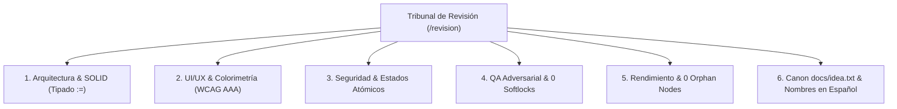

# 🛡️ Tribunal Supremo de Revisión (`/revision`)

> **Ámbito de Aplicación**: Todo el workspace de `juego` y sus subdirectorios.  
> **Modo Operativo**: Activo de manera permanente e incondicional en **cada mensaje y acción técnica**.  
> **Objetivo**: Asegurar la excelencia ingenieril, coherencia de autor y blindaje del código.

---

## 🏛️ 1. Mandato de Ejecución Automática Continua

De acuerdo con las directivas solemnes de [AGENTS.md](file:///c:/Users/curso/OneDrive/Documentos/iita_max/juego/AGENTS.md) y [CLAUDE.md](file:///c:/Users/curso/OneDrive/Documentos/iita_max/juego/CLAUDE.md):
- La skill `/revision` **no requiere invocación manual**; está habilitada en cada turno de trabajo.
- Toda propuesta, script, escena, refactor o asset entregado debe satisfacer previamente los estándares de este Tribunal antes de presentarse al usuario.

---

## ⚖️ 2. Las 6 Dimensiones del Tribunal de Auditoría

### 1. 🏗️ Arquitectura & Código Limpio
- Principios SOLID, DRY y KISS; modularidad orientada a componentes.
- **Tipado estricto obligatorio (`:=`)** en todo GDScript; cero tipos implícitos `Variant` innecesarios.
- Nodos protegidos contra referencias nulas con `is_instance_valid()`.

### 2. 🎨 UI/UX & Colorimetría
- Relación de contraste de texto **superior a 7:1** (WCAG 2.1 AAA).
- Proporción visual 60-30-10 con materiales de herrería medieval auténtica.
- **Veto absoluto a clichés genéricos de IA** (degradados violetas/neón, esquinas desmedidas).

### 3. 🔒 Seguridad & Manejo de Estados
- Validación defensiva de datos y desacoplamiento estricto por señales (signals).
- Estados de máquina (FSM) atómicos y predecibles.

### 4. 🧪 QA & Resiliencia
- Cobertura de casos de borde y esquinas conflictivas.
- Resiliencia frente a pulsaciones masivas (spam) o pérdida de foco.

### 5. ⚡ Rendimiento
- Cero cálculos o instanciaciones superfluas en `_process`.
- Reciclado dinámico de tweens y pools de reproductores de audio.
- Cero nodos huérfanos (`orphan nodes = 0`).

### 6. 📜 Fidelidad al Canon de Diseño
- **Lectura obligatoria previa de `docs/idea.txt`**: Prohibido divagar o improvisar mecánicas ajenas.
- **Nombres de nodos del SceneTree 100% en español**: Legibilidad inmediata en el editor de Godot.
- Arbitraje de oficio verificado con [`/herrero`](file:///C:/Users/curso/.gemini/antigravity/skills/herrero/SKILL.md).

---

## 🎭 3. Modalidad de Auditoría Multi-Rol

El Tribunal puede emitir auditorías especializadas adaptadas a cada disciplina técnica:
- **`/revision programador_godot`**: Audita GDScript, tipado, signals y fugas de memoria.
- **`/revision disenador_de_niveles`**: Audita oclusión estanca, Physics Layers y colisiones.
- **`/revision game_feel`**: Audita curvas de juice, decaimiento exponencial y elasticidad.
- **`/revision disenador_grafico`**: Audita contraste WCAG 2.1 AAA y fidelidad medieval.
- **`/revision sonidista`**: Audita ruteo de buses, ducking dinámico y pitch jitter.
- **`/revision herrero`**: Audita fidelidad a la termodinámica, escala de radiación y forja real.

---

## 📋 4. Formato Canónico del Veredicto

Al auditar una entrega, el Tribunal concluye con una de tres sentencias formales:
- 🟢 **APROBADO**: Cumple al 100% con las 6 dimensiones; listo para integrarse.
- 🟡 **OBSERVADO**: Requiere ajustes menores que no comprometen la estabilidad general.
- 🔴 **RECHAZADO**: Incumple mandatos críticos (tipado débil, nodos en inglés, clichés de IA, desvío de `docs/idea.txt`); debe rehacerse de inmediato.
