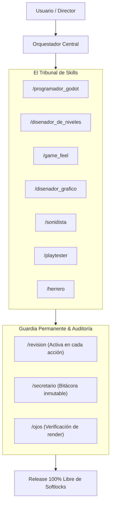

# 🏛️ CATÁLOGO MAESTRO DEL TRIBUNAL DE SKILLS: 'YUNQUE & SOMBRA'

> **Ámbito de Aplicación**: Proyecto *Yunque & Sombra* (`iita_max/juego`)  
> **Motor**: Godot Engine 4.x (GDScript 4 tipado estricto `:=`)  
> **Estándar**: Skills Antigravity / Gemini (`SKILL.md` con frontmatter YAML, directivas, mandatos y checklists)  
> **Repositorio Oficial**: `https://github.com/maximobal2576/Yunque_y_Sombra.git`  
> **Estado**: 🟢 100% Reconstituidas, Verificadas y Operativas en el Sistema

---

## 📑 ÍNDICE DEL CATÁLOGO

1. [Visión General del Tribunal Multi-Agente](#1-visión-general-del-tribunal-multi-agente)
2. [Matriz de Ubicación y Rutas Físicas](#2-matriz-de-ubicación-y-rutas-físicas)
3. [Catálogo Detallado por Skill](#3-catálogo-detallado-por-skill)
   - [1. `/programador_godot` — Líder de Arquitectura y Gameplay](#1-programador_godot--líder-de-arquitectura-y-gameplay)
   - [2. `/disenador_de_niveles` — Arquitecto Espacial y Greyboxing](#2-disenador_de_niveles--arquitecto-espacial-y-greyboxing)
   - [3. `/game_feel` — Ingeniero de Interacción y Juice Táctil](#3-game_feel--ingeniero-de-interacción-y-juice-táctil)
   - [4. `/disenador_grafico` — Director de Arte y Estilista 2D](#4-disenador_grafico--director-de-arte-y-estilista-2d)
   - [5. `/sonidista` — Diseñador Acústico y Foley Orgánico](#5-sonidista--diseñador-acústico-y-foley-orgánico)
   - [6. `/playtester` — QA Adversarial y Cazador de Softlocks](#6-playtester--qa-adversarial-y-cazador-de-softlocks)
   - [7. `/revision` — Tribunal Permanente de Auditoría Técnica](#7-revision--tribunal-permanente-de-auditoría-técnica)
   - [8. `/secretario` — Cronista Imperial de Campo (Taishi 太史)](#8-secretario--cronista-imperial-de-campo-taishi-太史)
   - [9. `/ojos` — Auditor Sensorial Visual Multimodal](#9-ojos--auditor-sensorial-visual-multimodal)
   - [10. `/herrero` — Consultor Experto en Metalurgia Tradicional](#10-herrero--consultor-experto-en-metalurgia-tradicional)
4. [Flujo de Trabajo y Protocolo de Invocación](#4-flujo-de-trabajo-y-protocolo-de-invocación)
5. [Mandatos Inviolables Compartidos](#5-mandatos-inviolables-compartidos)

---

## 1. Visión General del Tribunal Multi-Agente

El desarrollo de *Yunque & Sombra* opera bajo un modelo de **Tribunal Autónomo Especializado**. En lugar de un asistente genérico que improvisa o mezcla dominios, cada aspecto del videojuego está custodiado por una skill con identidad rigurosa, directivas inmutables y checklists de validación que impiden la deuda técnica, las regresiones visuales y los desvíos narrativos.



---

## 2. Matriz de Ubicación y Rutas Físicas

Para garantizar portabilidad absoluta y compatibilidad inmediata con el motor Antigravity y la sesión activa, cada una de las 10 skills ha sido desplegada en 5 ubicaciones sincronizadas:

| N° | Entorno | Ruta Absoluta del Directorio de Skills | Propósito |
| :-: | :--- | :--- | :--- |
| **1** | **Antigravity Global (Sesión Activa)** | `C:\Users\curso\.gemini\antigravity\skills\<skill_name>\SKILL.md` | Invocación inmediata por slash command (`/skill`) en cualquier ventana de chat. |
| **2** | **Workspace Root Antigravity** | `c:\Users\curso\OneDrive\Documentos\iita_max\.gemini\antigravity\skills\<skill_name>\SKILL.md` | Configuración a nivel de workspace en Antigravity. |
| **3** | **Workspace Root Gemini** | `c:\Users\curso\OneDrive\Documentos\iita_max\.gemini\skills\<skill_name>\SKILL.md` | Soporte de tooling estándar de Gemini CLI / IDE. |
| **4** | **Proyecto Juego Local (.gemini)** | `c:\Users\curso\OneDrive\Documentos\iita_max\juego\.gemini\skills\<skill_name>\SKILL.md` | Persistencia y trazabilidad dentro del repositorio de Godot. |
| **5** | **Proyecto Juego Portable (.agent)** | `c:\Users\curso\OneDrive\Documentos\iita_max\juego\.agent\skills\<skill_name>\SKILL.md` | Estándar agnóstico git para portabilidad entre diferentes máquinas. |

---

## 3. Catálogo Detallado por Skill

---

### 1. `/programador_godot` — Líder de Arquitectura y Gameplay
- **Comando Principal**: `/programador_godot`
- **Subcomandos / Tags**: `/programador_godot fix`, `/programador_godot review`, `/programador_godot refactor`
- **Competencias Técnicas**:
  * Arquitectura general en Godot 4.x con GDScript fuertemente tipado (`:=`).
  * Gestión de Autoloads persistentes (`GameManager`, `TimeManager`, `InventoryManager`, `AudioManager`).
  * Máquinas de Estados Finitos (FSM) para ciclo de vida y clientes.
  * Buses de eventos desacoplados mediante `Signal` con argumentos tipados.
  * Gestión de memoria estricta: Erradicación total de fugas (`orphan nodes == 0`).
  * Blindaje defensivo de punteros (`is_instance_valid`) y reciclaje de Tweens.
- **Cuándo Usarla**:
  * Al escribir o modificar cualquier archivo `.gd` o escena `.tscn`.
  * Al integrar nuevas mecánicas de forja, minería, clientes o diálogo.
  * Al corregir advertencias o errores de compilación en Godot.

---

### 2. `/disenador_de_niveles` — Arquitecto Espacial y Greyboxing
- **Comando Principal**: `/disenador_de_niveles`
- **Subcomandos / Tags**: `/disenador_de_niveles greybox`, `/disenador_de_niveles collision_check`, `/disenador_de_niveles occlusion`
- **Competencias Técnicas**:
  * Diseño de escenarios 2D mediante `TileMapLayer`, `StaticBody2D` y `Area2D`.
  * Topología de distribución cardinal estanca en la casa del tío (Izquierda: Taller, Frente: Mina, Derecha: Cama).
  * Sistema de oclusión de salas (*Room Occlusion / Fog*): Penumbra sobre recintos no transitados.
  * Matriz canónica de Physics Layers (1: Mundo, 2: Jugador, 3: Interacciones, 4: Triggers, 5: DeathZones).
  * Cinemática espacial y métricas: Pasillos holgados (32-48 px), prevención de atascos en aristas.
  * Límites estancos de `Camera2D` para evitar mostrar vacíos fuera del escenario.
- **Cuándo Usarla**:
  * Al modelar nuevos recintos, galerías de la mina subterránea o plazas del pueblo.
  * Al ajustar colisiones físicas o triggers de teletransporte.
  * Al verificar que el jugador no quede atrapado en esquinas de 90°.

---

### 3. `/game_feel` — Ingeniero de Interacción y Juice Táctil
- **Comando Principal**: `/game_feel`
- **Subcomandos / Tags**: `/game_feel juice`, `/game_feel calibrate_movement`, `/game_feel hitstop`
- **Competencias Técnicas**:
  * Aceleración y fricción con decaimiento exponencial frame-rate independent (`1.0 - exp(-decay * delta)`).
  * Frenado y giro reactivo (*Turn-Around Boost* instantáneo ante cambios de dirección).
  * Coyote Time (80-120 ms) y Jump/Action Buffering (100-150 ms).
  * Temblor de cámara no lineal: *Trauma Shake* cuadrático (`trauma^2`).
  * Micro-pausas táctiles (*Hitstop* de 2 a 4 frames) al golpear yunque o picar rocas.
  * Elasticidad *Squash & Stretch* en fuelles, martillos, campanas y botones interactivos.
  * Deformación física interactiva de `Polygon2D` al impactar metal caliente.
- **Cuándo Usarla**:
  * Cuando los controles del avatar o del ratón se sientan rígidos o patinen como en hielo.
  * Al diseñar o pulir la respuesta visual/física de una herramienta o minijuego.
  * Al sincronizar impactos audiovisuales en las estaciones de forja.

---

### 4. `/disenador_grafico` — Director de Arte y Estilista 2D
- **Comando Principal**: `/disenador_grafico`
- **Subcomandos / Tags**: `/disenador_grafico palette_check`, `/disenador_grafico generate_sprite`, `/disenador_grafico ui_theme`
- **Competencias Técnicas**:
  * Dirección de arte medieval realista: roble centenario, hierro martillado al carbono, acero pulido, mampostería de granito, bronce oxidado y pergamino de oveja.
  * Escala cromática de radiación de cuerpo negro (fuego natural y metal incandescente: naranja fuego -> rojo cereza -> gris acero).
  * Regla de proporción visual 60-30-10 (60% fondos rústicos, 30% estructuras y herramientas, 10% acentos focales cálidos).
  * Certificación estricta de contraste WCAG 2.1 AAA (relación > 7:1 en textos).
  * Generación determinista de assets vía scripts de Python (PIL / NumPy).
  * Veto total a clichés de IA (degradados violeta/neón, tipografías ilegibles, bordes exagerados).
- **Cuándo Usarla**:
  * Al generar, texturizar o componer nuevos sprites o tilesets.
  * Al maquetar ventanas, modales, pergaminos o la barra inferior persistente.
  * Al auditar que la iluminación 2D conserve la atmósfera de claroscuro.

---

### 5. `/sonidista` — Diseñador Acústico y Foley Orgánico
- **Comando Principal**: `/sonidista`
- **Subcomandos / Tags**: `/sonidista ducking`, `/sonidista generate_foley`, `/sonidista mix`
- **Competencias Técnicas**:
  * Arquitectura jerárquica de buses (`Master` -> `Music`, `SFX`, `Ambient`, `UI`).
  * Atenuación dinámica (*Ducking* reactivo de -4 dB a -6 dB en música durante martillazos).
  * Micro-variación tonal (*Pitch Jitter* aleatorio $\pm 5\% - 8\%$) para suprimir el efecto ametralladora.
  * Carga ultra-rápida y resiliente de buffers PCM en caliente en runtime (`AudioStreamWAV`).
  * Síntesis procedural y foley de herrería (repique metálico de yunque, siseo continuo de vapor *TSSSS*, soplido de fuelle, corte de tijera, tintineo de monedas).
  * Normalización comercial de sonoridad a -14 / -16 LUFS integrados.
- **Cuándo Usarla**:
  * Al añadir o sustituir efectos sonoros en las estaciones o bucles del juego.
  * Al calibrar el balance de volumen y evitar saturación o clipping digital.
  * Al integrar música adaptativa para las fases diurna y nocturna.

---

### 6. `/playtester` — QA Adversarial y Cazador de Softlocks
- **Comando Principal**: `/playtester`
- **Subcomandos / Tags**: `/playtester run_suite`, `/playtester stress_forge`, `/playtester corner_clip`
- **Competencias Técnicas**:
  * Asedio a vértices y esquinas críticas (*Corner Clipping* en colisiones).
  * Inyección de entradas contradictorias simultáneas (SOCD: Izq+Der / Arr+Abj).
  * Inundación de eventos a 60 Hz (spam clicks en campana, fuelles, puertas).
  * Validación de límites de tiempo: Desmayos a las 00:00 (taller vs exterior vs mina).
  * Pruebas de estrés continuo: 5 a 10 ciclos completos de forja consecutivos sin fugas.
  * Supervisión del monitor de nodos huérfanos (`orphan nodes == 0`).
  * Ejecución de la suite automatizada headless `tests/playtest_gameplay_loop.gd`.
- **Cuándo Usarla**:
  * Antes de cerrar cualquier fase de desarrollo o emitir una release.
  * Tras refactorizar cinemáticas, colisiones o máquinas de estados.
  * Cuando se requiera un certificado formal de robustez sin softlocks.

---

### 7. `/revision` — Tribunal Permanente de Auditoría Técnica
- **Comando Principal**: `/revision` (o `/revision [rol]`, ej. `/revision herrero`)
- **Subcomandos / Tags**: `/revision code`, `/revision art`, `/revision sound`, `/revision full`
- **Competencias Técnicas**:
  * **Modo Operativo**: Activo de manera permanente e incondicional en cada mensaje (según `AGENTS.md`).
  * Evaluación en 6 dimensiones:
    1. Arquitectura & Código Limpio (SOLID, DRY, KISS, tipado `:=`, punteros seguros).
    2. UI/UX & Colorimetría (WCAG 2.1 AAA > 7:1, 60-30-10, veto anti-IA).
    3. Seguridad & Manejo de Estados (datos defensivos, desacoplamiento por señales).
    4. QA & Resiliencia (0 softlocks, tolerancia a pérdida de foco).
    5. Rendimiento (sin sobrecarga en `_process`, 0 orphan nodes).
    6. Canon `docs/idea.txt` (nodos del SceneTree 100% en español).
  * Emisión de veredictos vinculantes: 🟢 APROBADO, 🟡 OBSERVADO, 🔴 RECHAZADO.
- **Cuándo Usarla**:
  * Su cumplimiento es implícito en cada turno; se invoca explícitamente para emitir un dictamen exhaustivo previo a la entrega de hitos.

---

### 8. `/secretario` — Cronista Imperial de Campo (Taishi 太史)
- **Comando Principal**: `/secretario`
- **Subcomandos / Tags**: `/secretario registrar_acta`, `/secretario sync`, `/secretario status`
- **Competencias Técnicas**:
  * Guardia perpetua ininterrumpida: Documenta en segundo plano sin frenar al desarrollador.
  * Redacción formal de actas imperiales en [CRONICA_DE_CAMPO.md](file:///c:/Users/curso/OneDrive/Documentos/iita_max/juego/CRONICA_DE_CAMPO.md).
  * Estructura protocolar: Sello temporal, problema, decisión canónica, alternativas descartadas, código afectado y certificación de QA.
  * Trazabilidad completa con hipervínculos absolutos `file:///`.
  * Preservación del estilo solemne de autor (Bordó noble, carbón cálido, marfil, oro).
- **Cuándo Usarla**:
  * Al concluir una sesión de trabajo, hito importante o decisión arquitectónica.
  * Al auditar la historia de cambios o resolver inconsistencias entre actas previas.

---

### 9. `/ojos` — Auditor Sensorial Visual Multimodal
- **Comando Principal**: `/ojos`
- **Subcomandos / Tags**: `/ojos inspect_ui`, `/ojos check_station [nombre]`, `/ojos capture`
- **Competencias Técnicas**:
  * Captura directa y análisis del viewport en tiempo real de Godot (1280x720).
  * Auditoría espacial de UI: Márgenes, safe zones, centrado de retratos en vanos góticos.
  * Detección de solapamientos: Verifica que botones como `Aceptar Comanda [ENTER]` estén visibles.
  * Eliminación de vacíos negros: Comprueba fondos continuos en todas las subestaciones.
  * Inspección de retroalimentación dinámica: Aguja rotatoria del manómetro térmico, partículas de vapor y deformación poligonal.
- **Cuándo Usarla**:
  * Tras modificar maquetaciones de UI, anclajes o escenas en primera persona.
  * Para diagnosticar desajustes visuales reportados por playtesters o diseñadores.
  * Como evidencia visual adjunta en las actas de `/secretario`.

---

### 10. `/herrero` — Consultor Experto en Metalurgia Tradicional
- **Comando Principal**: `/herrero`
- **Subcomandos / Tags**: `/herrero audit_forge`, `/herrero recipe_check`, `/herrero physics`
- **Competencias Técnicas**:
  * Arbitraje objetivo e independiente de la forja artesanal medieval.
  * Termodinámica de fraguas: Inercia de carbón, inyección forzada de oxígeno con fuelle (+12.5°C/bombeo) y decaimiento calórico (~5°C/s).
  * Escala física de radiación de cuerpo negro (naranja incandescente 950°C-1050°C óptimo de forja plástica; rojo cereza para templado; gris frío < 500°C frágil).
  * Dinámica del yunque: Conservación de volumen (desplazamiento de masa lateral bajo el martillo) y masa de rebote.
  * Metalurgia del temple: Choque térmico en agua, transformación martensítica, efecto Leidenfrost (*TSSSS*) y formación de cascarilla de óxido ($Fe_3O_4$).
  * Derecho a veto técnico sobre mecánicas absurdas o irreales en el taller.
- **Cuándo Usarla**:
  * Al diseñar o calibrar estaciones de forja, recetas de herramientas y tiempos térmicos.
  * Al auditar que los efectos visuales y sonoros correspondan a la herrería real.

---

## 4. Flujo de Trabajo y Protocolo de Invocación

Para avanzar con máxima solidez en cualquier etapa del proyecto, el Tribunal sigue el **Protocolo de Compuerta (Gating Rule)**:

```text
[1. Requerimiento]
       ↓
[2. /programador_godot + /disenador_de_niveles + /disenador_grafico + /sonidista]  (Construcción)
       ↓
[3. /herrero]                                                                     (Validación de Oficio)
       ↓
[4. /ojos]                                                                        (Inspección Ocular)
       ↓
[5. /playtester]                                                                  (QA Destructivo & Suite Headless)
       ↓
[6. /revision]                                                                    (Auditoría Vincualnte de 6 Dimensiones)
       ↓
[7. /secretario]                                                                  (Asiento Inmutable en Crónica)
```

---

## 5. Mandatos Inviolables Compartidos

Todo agente que opere en el proyecto *Yunque & Sombra* debe respetar tres mandatos supremos:

1. 📜 **Lectura Previa Obligatoria de `docs/idea.txt`**:
   - Fuente canónica y suprema de verdad. Prohibido inventar mecánicas fuera de tono.
2. 🇪🇸 **Nodos del SceneTree 100% en Español**:
   - Todo nodo dentro de archivos `.tscn` debe estar nombrado en español comprensible (`BotonAtizarFuelle`, `HornoFragua`, `LingoteDeformable`, etc.).
3. 🛡️ **Auditoría Continua de `/revision`**:
   - No se entrega ningún archivo con warnings, tipos variantes implícitos ni contrastes deficientes.
