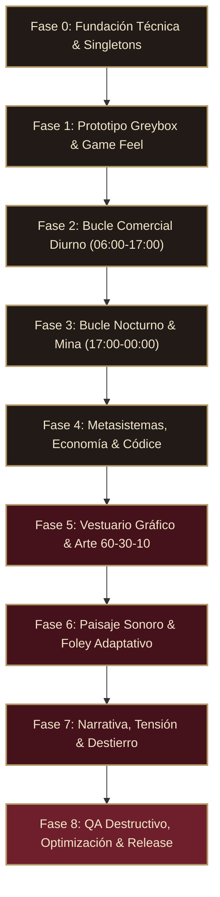

# ⚒️ YUNQUE & SOMBRA: GUÍA MAESTRA DE ETAPAS, SKILLS Y ARQUITECTURA TÉCNICA
> **Documento Guía Operativo de Producción & Matriz de Habilidades**  
> **Motor**: Godot Engine 4.x (GDScript con tipado estricto `:=`)  
> **Arquitectura**: Desacoplada por Componentes, Orientada a Eventos & Singletons de Estado  
> **Fuentes Canónicas del Proyecto**:  
> - 📜 **GDD Canónico**: [docs/idea.txt](file:///c:/Users/admin/Documents/01_Academico_IITA/iita/juego/docs/idea.txt)  
> - 📋 **Plan de Acción Integral**: [docs/plan_de_accion.txt](file:///c:/Users/admin/Documents/01_Academico_IITA/iita/juego/docs/plan_de_accion.txt)  
> - 🏛️ **Bitácora Inmutable**: [CRONICA_DE_CAMPO.md](file:///c:/Users/admin/Documents/01_Academico_IITA/iita/juego/CRONICA_DE_CAMPO.md)

---

## 📑 ÍNDICE GENERAL DE ETAPAS DE DESARROLLO

1. [Fase 0: Fundación Técnica, Infraestructura & Singletons](#fase-0-fundación-técnica-infraestructura--singletons)
2. [Fase 1: Prototipo Funcional Greybox & Game Feel (Testing Temprano)](#fase-1-prototipo-funcional-greybox--game-feel-testing-temprano)
3. [Fase 2: Bucle Comercial Diurno — El Mostrador de Forja Táctil (06:00 - 17:00)](#fase-2-bucle-comercial-diurno--el-mostrador-de-forja-táctil-0600---1700)
4. [Fase 3: Bucle Nocturno — Exploración Top-Down & Mina Subterránea (17:00 - 00:00)](#fase-3-bucle-nocturno--exploración-top-down--mina-subterránea-1700---0000)
5. [Fase 4: Metasistemas, Economía, Mueblería de Juan & Códice Manchado](#fase-4-metasistemas-economía-mueblería-de-juan--códice-manchado)
6. [Fase 5: Vestuario Gráfico, Iluminación 2D & Dirección de Arte](#fase-5-vestuario-gráfico-iluminación-2d--dirección-de-arte)
7. [Fase 6: Paisaje Sonoro, Foley & Música Adaptativa](#fase-6-paisaje-sonoro-foley--música-adaptativa)
8. [Fase 7: Narrativa, Tensión Sociopolítica & Clímax (El Destierro)](#fase-7-narrativa-tensión-sociopolítica--clímax-el-destierro)
9. [Fase 8: QA Destructivo, Hardening, Optimización & Release](#fase-8-qa-destructivo-hardening-optimización--release)

---

## 🧠 EL TRIBUNAL DE SKILLS: GRUPO MULTI-AGENTE AUTÓNOMO

Cada etapa del desarrollo cuenta con la intervención orquestada de roles especializados que operan bajo protocolos estrictos de calidad, diseño anti-IA y solidez de ingeniería:

| Skill / Agente | Enfoque Primario y Competencias Técnicas |
| :--- | :--- |
| **`/programador_godot`** | Arquitectura general en Godot 4, GDScript tipado estricto, gestión de Singletons (Autoloads), buses de señales, state machines y desacoplamiento de datos. |
| **`/disenador_de_niveles`** | Greyboxing/whiteboxing, cinemática espacial, métricas de movimiento, colisiones herméticas, prevención de softlocks, triggers y modularidad de mapas. |
| **`/game_feel`** | Juice de interacción: aceleración y fricción exponencial, Turn-Around boost, micro-pausas (Hitstop), Trauma Shake en cámara, elasticidad Squash & Stretch en forja. |
| **`/disenador_grafico`** | Dirección de arte medieval rústica, paleta de autor 60-30-10 (`#211a16`, `#6e1f2b`, `#b59a6a`), contraste WCAG 2.1 AAA, iluminación dinámica 2D y rechazo de clichés de IA. |
| **`/sonidista`** | Arquitectura de buses de audio en Godot, audio adaptativo, ducking reactivo, micro-variación tonal (+/- 7%), efectos Foley de metalurgia y calidez acústica. |
| **`/playtester`** | QA adversarial destructivo: corner clipping, entradas simultáneas contradictorias (SOCD), spamming a 60 Hz, verificación de desmayo y límites de cámara. |
| **`/revision`** | Tribunal de auditoría obligatorio: principios SOLID, modularidad, tipado estricto, prevención de memory leaks, seguridad de estados y revisión continua. |
| **`/secretario`** | Cronista imperial permanente: registro histórico e inmutable de decisiones, arquitectura, cambios de código e hitos en [CRONICA_DE_CAMPO.md](file:///c:/Users/admin/Documents/01_Academico_IITA/iita/juego/CRONICA_DE_CAMPO.md). |
| **`/ojos`** | Inspección visual multimodal de la pantalla en tiempo real: verificación de colisiones, render de iluminación, estética del viewport y detección de artefactos gráficos. |

---

## 📊 MATRIZ RESUMEN: MAPEO DE SKILLS POR ETAPA

| Etapa | `/programador_godot` | `/disenador_de_niveles` | `/game_feel` | `/disenador_grafico` | `/sonidista` | `/playtester` | `/revision` | `/secretario` |
| :--- | :---: | :---: | :---: | :---: | :---: | :---: | :---: | :---: |
| **Fase 0: Fundación & Infraestructura** | **★ Líder** | ● Soporte | ○ | ○ | ○ | ● Smoke Test | **✔ Auditoría** | **✔ Registro** |
| **Fase 1: Prototipo Greybox & Game Feel** | ● Co-Líder | **★ Líder** | **★ Líder** | ○ | ○ | ● Testing | **✔ Auditoría** | **✔ Registro** |
| **Fase 2: Bucle Comercial Diurno** | **★ Líder** | ● Pacing | ● Juice Forja | ○ | ● Foley Draft | ● Balance | **✔ Auditoría** | **✔ Registro** |
| **Fase 3: Bucle Nocturno & Mina** | **★ Líder** | **★ Geometría** | ● Picado | ○ | ○ | ● Triggers | **✔ Auditoría** | **✔ Registro** |
| **Fase 4: Metasistemas & Progresión** | **★ Líder** | ● Decoración | ● Feedback | ○ | ○ | ● Edge Cases | **✔ Auditoría** | **✔ Registro** |
| **Fase 5: Dirección de Arte & Gráficos** | ● Soporte UI | ● Tilesets | ● Animación | **★ Líder** | ○ | ● UI Check | **✔ Auditoría** | **✔ Registro** |
| **Fase 6: Audio, Foley & Adaptabilidad** | ● Bus Hook | ○ | ● Sync Juice | ○ | **★ Líder** | ● Audio QA | **✔ Auditoría** | **✔ Registro** |
| **Fase 7: Narrativa & Clímax** | **★ Líder** | ● Escenografía | ● Tensión | ● Cinemática | ● Clímax SFX | ● Flujo Narrativo | **✔ Auditoría** | **✔ Registro** |
| **Fase 8: QA Destructivo & Release** | ● Fixes | ● Colisiones | ● Calibración | ● Polish | ● Normalización | **★ Destructor** | **✔ Auditoría Final** | **✔ Cierre** |

*Leyenda: **★ Líder** (Responsable principal) | ● (Participante activo / soporte) | **✔** (Auditoría/Registro obligatorio en cada fase) | ○ (Inactivo o diferido).*

---

## 🛠️ ESPECIFICACIÓN DETALLADA DE LAS 9 ETAPAS



---

### FASE 0: FUNDACIÓN TÉCNICA, INFRAESTRUCTURA & SINGLETONS

#### 🎯 Objetivo Clave
Establecer los cimientos arquitectónicos del proyecto en Godot 4: definir la configuración de renderizado, mapeo canónico de entradas, capas de colisión física (Physics Layers) y desplegar los gestores globales persistentes (Autoloads) con tipado estricto e interfaces desacopladas.

#### 👥 Skills a Utilizar y Roles Específicos
- **`/programador_godot`**: Configura `project.godot`, crea los Autoloads `GameManager.gd`, `TimeManager.gd` e `InventoryManager.gd` con enums, signals fuertemente tipadas y máquinas de estados.
- **`/disenador_de_niveles`**: Establece la matriz canónica de capas de físicas (Mundo, Jugador, Interacciones, Triggers, DeathZones).
- **`/revision`**: Audita la nomenclatura, el tipado estricto (`:=`), previene ciclos de dependencia en los singletons y verifica la limpieza de warnings.
- **`/secretario`**: Documenta en [CRONICA_DE_CAMPO.md](file:///c:/Users/admin/Documents/01_Academico_IITA/iita/juego/CRONICA_DE_CAMPO.md) la decisión de arquitectura y la versión base de Godot 4.

#### 📁 Archivos Producidos / Modificados
- `project.godot`: Configuración de resolución (1280x720, `keep_height`), Input Map (`move_*`, `interact`, `action`, `cancel_escape`) y capas físicas de 2D.
- `src/autoloads/GameManager.gd`: Singleton del ciclo de vida (`STATE_MENU`, `STATE_OVERWORLD`, `STATE_WORKSHOP`, `STATE_MINING`, `STATE_PAUSE`, `STATE_CINEMATIC`).
- `src/autoloads/TimeManager.gd`: Reloj continuo de 24 horas, aceleración de sueño (timelapse), emisión de señales horarias (`hour_changed`, `day_phase_changed`).
- `src/autoloads/InventoryManager.gd`: Gestor de inventario (minerales, carbón, lingotes, herramientas, oro y recetas conocidas).

#### 🧪 Criterios de Prueba & Testing Gate
1. **Ejecución Limpia**: El proyecto abre y compila sin advertencias ni errores en la consola de Godot 4.
2. **Acceso a Singletons**: Cualquier script puede invocar `GameManager`, `TimeManager` e `InventoryManager` sin colisiones de carga.
3. **Mapeo de Entradas**: Las acciones del Input Map emiten valores válidos de vector (`Input.get_vector()`).

---

### FASE 1: PROTOTIPO FUNCIONAL GREYBOX & GAME FEEL (TESTING TEMPRANO)

#### 🎯 Objetivo Clave
Lograr un núcleo jugable (Core Gameplay Loop) completamente operativo y satisfactorio utilizando formas geométricas simples (greyboxing/whiteboxing). Validar la respuesta del movimiento del jugador (Game Feel), el primer minijuego de forja y la transición diurna/nocturna antes de invertir en assets gráficos.

#### 👥 Skills a Utilizar y Roles Específicos
- **`/game_feel`**: Implementa aceleración/fricción con decaimiento exponencial frame-rate independent, frenado reactivo (*Turn-Around Boost* instantáneo), elasticidad en cámara (*position smoothing*) e impulsos elásticos.
- **`/disenador_de_niveles`**: Modela `GreyboxTown.tscn` delimitando el taller, el mostrador, el yunque, el fuelle, la tina de agua, la cama y la salida al patio. Verifica la ausencia de trampas geométricas.
- **`/programador_godot`**: Codifica el controlador `Player.gd`, el componente de interacción `InteractableArea.gd`, el minijuego `MiniForge.gd` y el HUD funcional `MainHUD.tscn`.
- **`/playtester`**: Prueba el movimiento en esquinas (corner friction), cambios rápidos de dirección (SOCD) e interactividad de la forja.
- **`/revision`**: Revisa desacoplamiento entre componentes e interactuables (usando Duck Typing y señales de Godot).
- **`/secretario`**: Asienta la calibración de variables cinéticas del jugador en la crónica.

#### 📁 Archivos Producidos / Modificados
- `src/scenes/player/Player.tscn` y `src/scenes/player/Player.gd`: Controlador 2D (`CharacterBody2D`) con cinemática táctil y RayCast/Area de interacción.
- `src/scenes/levels/GreyboxTown.tscn` y `src/scenes/levels/GreyboxTown.gd`: Escena del pueblo y taller en bloques de color con colisiones estancas (`StaticBody2D`).
- `src/scenes/objects/InteractableArea.gd`: Componente base genérico para objetos interactuables del entorno.
- `src/scenes/workshop/MiniForge.tscn` y `src/scenes/workshop/MiniForge.gd`: Minijuego de forja en primer plano (calentamiento, aguja oscilante rítmica, enfriamiento y porcentaje de calidad).
- `src/scenes/ui/MainHUD.tscn` y `src/scenes/ui/MainHUD.gd`: Barra inferior persistente con reloj analógico/digital, barra de estamina y prompt de interacción (`[E] Interactuar`).

#### 🧪 Criterios de Prueba & Testing Gate
1. **Prueba Cinética Táctil**: El personaje se desplaza en 8 direcciones de forma ágil; al cambiar de izquierda a derecha el frenado es inmediato sin patinaje tosco.
2. **Ciclo de Forja Completo**: Interactuar con el yunque abre `MiniForge`; ejecutar el minijuego calcula la precisión y añade el objeto forjado al inventario.
3. **Ciclo de Descanso**: Acercarse a la cama y presionar `[E]` activa el timelapse de sueño acelerado en `TimeManager` y despierta a las 06:00 del día siguiente con estamina completa.

---

### FASE 2: BUCLE COMERCIAL DIURNO — EL MOSTRADOR DE FORJA TÁCTIL (06:00 - 17:00)

#### 🎯 Objetivo Clave
Implementar la experiencia de servicio y ritmo acelerado diurno (estilo *Papa's Freezeria* / *Potion Punch*): apertura del portón comercial corredizo, llegada de clientes con bocadillos de pedidos, barra de paciencia, ensamblaje de piezas por recetas y evaluación de satisfacción con cobro de oro y propinas.

#### 👥 Skills a Utilizar y Roles Específicos
- **`/programador_godot`**: Crea el generador de clientes `CustomerSpawner.gd`, la cola de espera, la lógica de órdenes aleatorias según catálogo y el cálculo de recompensas económicas.
- **`/game_feel`**: Afina el feedback de entrega de pedidos (animaciones de monedas flotantes, rebote de bocadillos de texto al ser completados y sacudida de alerta cuando la paciencia cae al 20%).
- **`/disenador_de_niveles`**: Calibra los puntos de spawn y la ruta de aproximación de clientes hacia el mostrador comercial (`Marker2D` y Navigation/Path2D).
- **`/playtester`**: Somete a estrés la cola de clientes: tiempos de espera al límite, pedidos que expiran simultáneamente y pedidos rápidos consecutivos.
- **`/revision`**: Audita la separación entre la lógica del cliente y el estado del taller, verificando que la paciencia use `delta` o `Timer` desacoplado.
- **`/secretario`**: Registra la tabla de recetas iniciales y la fórmula matemática de propinas y reputación.

#### 📁 Archivos Producidos / Modificados
- `src/scenes/workshop/ShopCounter.tscn` y `src/scenes/workshop/ShopCounter.gd`: Mostrador comercial con portón corredizo interactivo.
- `src/scenes/workshop/Customer.tscn` y `src/scenes/workshop/Customer.gd`: Nodo de cliente con bocadillo de diálogo, barra de paciencia y evaluación de entrega.
- `src/scenes/workshop/CustomerSpawner.gd`: Gestor de ritmo y cadencia de clientes durante el turno 06:00 - 17:00.
- `src/data/ForgeRecipes.gd`: Base de datos de recetas (Nivel 1: clavos, herraduras, tenedores; Nivel 2: hachas, dagas, picos; Nivel 3: espadas ceremoniales y orfebrería).
- `src/scenes/ui/DaySummaryModal.tscn`: Ventana modal desplegada a las 17:00 con el balance del día (monedas ganadas, propinas, pedidos exitosos y perdidos).

#### 🧪 Criterios de Prueba & Testing Gate
1. **Control de Horario Comercial**: A las 06:00 se habilita la interacción del mostrador y el portón sube; a las 17:00 suena la campana de cierre, el portón baja y se expulsa a los clientes pendientes.
2. **Paciencia y Cobro**: Clientes satisfechos otorgan propina proporcional a su paciencia restante; clientes agotados abandonan la tienda restando reputación.
3. **Bloqueo Espacial**: Durante el horario comercial, el jugador está enfocado en el taller; no puede deambular fuera del área operativa.

---

### FASE 3: BUCLE NOCTURNO — EXPLORACIÓN TOP-DOWN & MINA SUBTERRÁNEA (17:00 - 00:00)

#### 🎯 Objetivo Clave
Construir el bucle de exploración y aventura al atardecer: descenso a la mina subterránea mediante túneles oscuros con iluminación dinámica 2D, extracción de minerales mediante picado táctil, vida social en el pueblo con vecinos en sus hogares, compras en bazares y el estricto sistema de medianoche con penalizaciones por desmayo.

#### 👥 Skills a Utilizar y Roles Específicos
- **`/disenador_de_niveles`**: Diseña `MinaSubterranea.tscn` con múltiples galerías, áreas de oscuridad profunda, vetas de mineral distribuidas por dificultad y el mapa expandido del pueblo nocturno.
- **`/programador_godot`**: Desarrolla la mecánica de colocación de antorchas, el sistema de desmayo a las 00:00 en `TimeManager.gd`, el sistema de diálogos sencillos con NPCs y las tiendas del pueblo.
- **`/game_feel`**: Agrega *Trauma Shake* a la cámara al golpear rocas de mineral, partículas de astillas de piedra y la cinemática de revelación del *Hito del Primer Hierro*.
- **`/playtester`**: Evalúa situaciones de borde: quedar atrapado a oscuras, desmayarse en el punto más recóndito de la mina exactamente a las 00:00 y revisar la pérdida de inventario.
- **`/revision`**: Inspecciona la modularidad del sistema de iluminación para garantizar que no degrade el rendimiento en mapas extensos.
- **`/secretario`**: Documenta las penalizaciones de fatiga y la tabla de drops de minerales.

#### 📁 Archivos Producidos / Modificados
- `src/scenes/levels/MinaSubterranea.tscn` y `src/scenes/levels/MinaSubterranea.gd`: Nivel subterráneo con niebla de oscuridad (`CanvasModulate`).
- `src/scenes/objects/MineralVein.tscn` y `src/scenes/objects/MineralVein.gd`: Veta de mineral (carbón, cobre, hierro, plata, oro) con puntos de durabilidad y feedback visual.
- `src/scenes/objects/Torch.tscn`: Antorcha desplegable con `PointLight2D` y consumo de estamina o inventario.
- `src/scenes/npcs/TownNPC.tscn` y `src/scenes/npcs/TownNPC.gd`: Aldeanos con rutinas nocturnas y diálogos ambientales.
- `src/scenes/shops/GeneralBazaar.tscn`: Tienda de suministros (solventes, antorchas, raciones de estamina).
- `src/scenes/cinematics/FirstIronCinematic.tscn`: Cinemática corta al quebrar la primera veta de hierro.

#### 🧪 Criterios de Prueba & Testing Gate
1. **Mecánica de Iluminación & Minería**: La mina inicia en penumbra total; portar o colocar antorchas disipa la niebla; picar una veta resta estamina y deposita el recurso en `InventoryManager`.
2. **Penalización de Medianoche**:
   - Dormir voluntariamente en cama antes de 00:00: Amanece a las 06:00 con 100% de energía.
   - Desmayo dentro del taller a las 00:00: Amanece con 50% de energía (fatiga sin robo).
   - Desmayo en la mina o pueblo a las 00:00: Amanece en cama con 40% de energía y deducción de oro y minerales recolectados.

---

### FASE 4: METASISTEMAS, ECONOMÍA, MUEBLERÍA DE JUAN & CÓDICE MANCHADO

#### 🎯 Objetivo Clave
Implementar los sistemas de retención y progresión a mediano y largo plazo: la compra de muebles y herramientas en la carpintería comunitaria de Juan (instalación automática nocturna con buffs pasivos), el árbol tecnológico táctil del Códice Manchado (fregado de suciedad con esponja y solventes) y la metaprogresión visual del pueblo en 3 estados.

#### 👥 Skills a Utilizar y Roles Específicos
- **`/programador_godot`**: Codifica el sistema de muebles comprables en `FurnitureManager.gd`, el minijuego de limpieza de máscaras de textura para el Códice (`StainedCodex.gd`) y el gestor de estados del poblado.
- **`/game_feel`**: Diseña el feedback háptico/visual del raspado y disolución de grasa y hollín en las páginas del libro antiguo.
- **`/disenador_de_niveles`**: Configura las variantes estructurales del mapa del pueblo (Etapa 1: barro y ruinas; Etapa 2: senderos de piedra y faroles; Etapa 3: adoquines, fuentes y esplendor).
- **`/playtester`**: Valida que los buffs de los muebles (ej. +20% paciencia de clientes) se apliquen de inmediato tras la instalación nocturna y no se dupliquen al recargar partidas.
- **`/revision`**: Audita la gestión de datos persistentes y la serialización en disco (Save/Load state).
- **`/secretario`**: Asienta en la bitácora las fórmulas de confort y el catálogo completo de muebles y recetas secretas.

#### 📁 Archivos Producidos / Modificados
- `src/scenes/shops/JuanCarpentry.tscn` y `src/scenes/shops/JuanCarpentry.gd`: Tienda de muebles comunitarios con diálogo cálido vecinal.
- `src/autoloads/FurnitureManager.gd`: Gestor de mobiliario activo y modificadores pasivos globales.
- `src/scenes/ui/StainedCodex.tscn` y `src/scenes/ui/StainedCodex.gd`: Interfaz del libro brillante con shader o render interactivo de limpieza con esponja.
- `src/scenes/levels/TownProgressionController.gd`: Controlador de capas y decoración ambiental reactivo a la economía del jugador.
- `src/data/SaveSystem.gd`: Serializador de estado del juego (reputación, mejoras, inventario, día actual).

#### 🧪 Criterios de Prueba & Testing Gate
1. **Instalación Nocturna de Juan**: Comprar un banco en la carpintería no lo entrega al instante; al dormir en la cama, a la mañana siguiente el banco aparece instalado en el taller y los clientes tardan más en enfadarse.
2. **Minijuego de Limpieza del Códice**: Usar un solvente comprado en el bazar permite fregar una página manchada; al superar el 85% de superficie limpia, la nueva receta se desbloquea en el inventario.
3. **Evolución del Pueblo**: Al superar los hitos económicos y donaciones comunitarias, los tiles del pueblo transicionan sin errores de oclusión ni glitches visuales.

---

### FASE 5: VESTUARIO GRÁFICO, ILUMINACION 2D & DIRECCIÓN DE ARTE

#### 🎯 Objetivo Clave
Reemplazar íntegramente la estética greybox por la dirección de arte canónica del autor: atmósfera medieval rústica, paleta estricta 60-30-10 (`#211a16`, `#6e1f2b`, `#b59a6a`), contraste certificado WCAG 2.1 AAA, iluminación 2D cálida y texturas de hierro forjado, barro, madera y piedra caliza, vetando clichés genéricos de IA.

#### 👥 Skills a Utilizar y Roles Específicos
- **`/disenador_grafico`**: Dirige la colorimetría, crea los tilesets 2D de autor, los sprites del protagonista y clientes, la iconografía de forja y supervisa el contraste mediante `/ojos`.
- **`/disenador_de_niveles`**: Aplica los nuevos TileMaps (`TileMapLayer` en Godot 4) respetando las cajas de colisión previamente validadas en el greybox.
- **`/game_feel`**: Incorpora squash & stretch en las animaciones de martilleo, partículas de chispas incandescentes en el yunque y nubes de vapor denso en la tina de templado.
- **`/revision`**: Realiza auditoría cromática y tipográfica estricta: prohíbe fuentes ilegibles, esquinas redondeadas exageradas y degradados violeta/azul cliché.
- **`/secretario`**: Registra los códigos HEX/OKLCH aprobados y la paleta maestra en [CRONICA_DE_CAMPO.md](file:///c:/Users/admin/Documents/01_Academico_IITA/iita/juego/CRONICA_DE_CAMPO.md).

#### 📁 Archivos Producidos / Modificados
- `assets/sprites/player/`: Hoja de sprites (Walk, Idle, Strike, Sleep).
- `assets/sprites/npcs/`: Sprites de aldeanos, Juan el carpintero y guardias feudales.
- `assets/tilesets/town_tileset.tres`: Tileset de autor con capas de terreno (barro, camino empedrado, madera envejecida).
- `assets/tilesets/mine_tileset.tres`: Tileset cavernoso con vetas de mineral incrustadas.
- `assets/ui/theme_author.tres`: Godot Theme con tipografía nítida de alto contraste, bordes sobrios y colores de autor.
- `src/shaders/FurnaceHeat.gdshader`: Shader de distorsión por calor en el horno de forja.

#### 🧪 Criterios de Prueba & Testing Gate
1. **Validación Visual (/ojos)**: Inspeccionar el render en pantalla asegurando que el fondo no sature, las piezas calientes sean el foco visual (10% de acento) y el texto mantenga un contraste > 7:1.
2. **Preservación de Físicas**: Cambiar los bloques geométricos por tiles no introduce atascos, huecos en paredes ni desajustes en el raycast de interacción.

---

### FASE 6: PAISAJE SONORO, FOLEY & MÚSICA ADAPTATIVA

#### 🎯 Objetivo Clave
Dotar a 'Yunque & Sombra' de una identidad acústica viva, orgánica y física: arquitectura de buses de audio en Godot 4, sistema de ducking dinámico, micro-variación tonal en impactos de metal para evitar fatiga auditiva y bandas sonoras contrastantes entre la labor diurna y el misterio nocturno.

#### 👥 Skills a Utilizar y Roles Específicos
- **`/sonidista`**: Diseña la estructura de buses en `default_bus_layout.tres`, implementa ducking entre música y martillazos (-4 dB reactivo), procesa los SFX de foley y compone/integra las pistas adaptativas.
- **`/game_feel`**: Sincroniza los efectos sonoros con los frames exactos de impacto (golpe de martillo, silbido del vapor en la tina, crujido de roca en la mina).
- **`/programador_godot`**: Crea el singleton `AudioManager.gd` con pools de reproductores reutilizables (`AudioStreamPlayer2D`) para evitar picos de instanciación.
- **`/playtester`**: Somete a prueba el audio martillando a alta velocidad para verificar que la micro-variación de pitch (+/- 7%) elimine la sensación de repetición robótica ("machine gun effect").
- **`/revision`**: Revisa que los archivos de audio utilicen formatos eficientes (Ogg Vorbis para pistas musicales, WAV sin compresión para impactos cortos de SFX).
- **`/secretario`**: Documenta el ruteo de buses y la atenuación decibélica en la bitácora.

#### 📁 Archivos Producidos / Modificados
- `default_bus_layout.tres`: Configuración de buses (Master, Music, SFX, Ambient, UI) con compresores y ducking configurados.
- `src/autoloads/AudioManager.gd`: Gestor de reproducción con control de volumen por canales y crossfade entre temas diurnos y nocturnos.
- `assets/audio/sfx/anvil_hit_*.wav`: Muestras de golpe de yunque con variaciones de impacto.
- `assets/audio/sfx/quench_steam.wav`: Siseo prolongado de enfriamiento en agua.
- `assets/audio/sfx/mine_pickaxe_*.wav`: Impactos de pico sobre roca sólida.
- `assets/audio/music/day_forge_theme.ogg`: Música diurna rústica (laúd, maderas, ritmo de trabajo).
- `assets/audio/music/night_mystery_theme.ogg`: Música nocturna sutil (viento, cuerdas tenues, grillos).

#### 🧪 Criterios de Prueba & Testing Gate
1. **Prueba de Fatiga Sonora**: Martillar 30 veces seguidas en el minijuego produce sutiles variaciones acústicas naturales sin fatiga perceptiva.
2. **Ducking & Crossfade**: Al martillar con fuerza, la música atenúa suavemente su volumen sin cortes abruptos; al cambiar de fase diurna a nocturna a las 17:00, la música cambia con un crossfade limpio de 2.5 segundos.

---

### FASE 7: NARRATIVA, TENSIÓN SOCIOPOLÍTICA & CLÍMAX (EL DESTIERRO)

#### 🎯 Objetivo Clave
Integrar el corazón argumental del juego: la narrativa ambiental de las notas del diario del tío herrero encontradas durante el trabajo, el punto de inflexión del Día 5 con la llegada de la guardia feudal exigiendo pertrechos de control y la secuencia culminante del clímax y giro argumental (el arresto y destierro bajo la tormenta).

#### 👥 Skills a Utilizar y Roles Específicos
- **`/programador_godot`**: Desarrolla el gestor de historia `StoryManager.gd`, la agenda de eventos por días (Día 1 a Día 5+), la recolección de pergaminos del diario y la secuencia programada del clímax final.
- **`/disenador_de_niveles`**: Coloca los puntos secretos de notas en el taller y la mina profunda; ambienta la escena de la emboscada final.
- **`/sonidista`**: Modela el corte absoluto de música la noche del desenlace (silencio tenso, solo lluvia y truenos) y la fanfarria amarga de los créditos.
- **`/disenador_grafico`**: Diseña el pergamino de la carta inicial de la madre, las notas arrugadas del tío y la cinemática de destierro en carruaje.
- **`/playtester`**: Comprueba que la progresión narrativa no se desincronice si el jugador avanza días sin forjar o si dedica noches enteras a la mina.
- **`/revision`**: Audita que los triggers narrativos sean idempotentes y no puedan dispararse dos veces en la misma partida.
- **`/secretario`**: Asienta el canon narrativo y la cronología exacta de las notas del tío.

#### 📁 Archivos Producidos / Modificados
- `src/autoloads/StoryManager.gd`: Gestor de banderas narrativas (`JOURNAL_PIECES_FOUND`, `FEUDAL_TENSION_LEVEL`, `DAY_COUNT`).
- `src/scenes/narrative/PrologueLetterModal.tscn`: Carta pergamino de la madre al iniciar una partida nueva.
- `src/scenes/narrative/JournalEntryModal.tscn`: Visor de fragmentos encontrados del tío herrero.
- `src/scenes/narrative/FeudalGuardCustomer.tscn`: Cliente especial de la guardia con encargos oscuros y diálogos intimidantes.
- `src/scenes/cinematics/ExileClimaxScene.tscn`: Escena cinemática interactiva del arresto y destierro hacia el páramo derruido.

#### 🧪 Criterios de Prueba & Testing Gate
1. **Descubrimiento Orgánico**: Arreglar vigas o picar fisuras profundas en la mina genera la caída del fragmento del diario y su lectura modal correspondiente.
2. **Inflexión del Día 5**: Al amanecer del Día 5, el guardia feudal se posiciona como cliente obligatorio; rechazar o completar su pedido avanza la tensión sin romper el ciclo comercial.
3. **Disparador del Clímax**: Al cumplir las condiciones de maestría y prosperidad comunitaria, la cinemática final toma el control del juego, culminando en los créditos sin errores de cámara ni audio residual.

---

### FASE 8: QA DESTRUCTIVO, HARDENING, OPTIMIZACIÓN & RELEASE

#### 🎯 Objetivo Clave
Someter la totalidad del videojuego a pruebas de estrés implacables, verificar la integridad de memoria, optimizar el framerate a 60 FPS estables en equipos modestos y exportar binarios comerciales pulidos para Windows.

#### 👥 Skills a Utilizar y Roles Específicos
- **`/playtester`**: Ejecuta la batería de pruebas destructivas:
  * Corner clipping en esquinas críticas de la mina y el taller.
  * Entradas simultáneas contradictorias (SOCD: Izquierda + Derecha / Arriba + Abajo).
  * Spam masivo de interacciones a 60 Hz sobre yunques, portones y camas.
  * Cambios forzados de resolución de pantalla y pérdida de foco (Alt+Tab).
  * Desmayos con inventario en su capacidad máxima.
- **`/revision`**: Inspecciona el profiling de memoria (`get_monitor`), asegura la ausencia de memory leaks de nodos huérfanos (`orphan nodes = 0`), audita que todo GDScript tenga tipado estricto y limpia comentarios de depuración.
- **`/programador_godot`**: Corrige las incidencias reportadas por el playtester y configura los perfiles de exportación de Godot 4.
- **`/sonidista`**: Normaliza el nivel sonoro global a estándares integrados (-14 LUFS).
- **`/secretario`**: Redacta el acta final de certificación de release en [CRONICA_DE_CAMPO.md](file:///c:/Users/admin/Documents/01_Academico_IITA/iita/juego/CRONICA_DE_CAMPO.md).

#### 📁 Archivos Producidos / Modificados
- `export_presets.cfg`: Ajustes de compilación de release para Windows Desktop (x86_64).
- `docs/QA_TEST_REPORT.md`: Informe técnico de incidencias encontradas y verificadas por el playtester.
- `builds/windows/YunqueYSombra.exe` y `builds/windows/YunqueYSombra.pck`: Paquete ejecutable final.

#### 🧪 Criterios de Prueba & Testing Gate
1. **Cero Nodos Huérfanos**: La sesión de juego de 15 minutos en bucle continuo reporta 0 `orphan_nodes` en el monitor de Godot.
2. **Resiliencia Total**: Ninguna combinación de teclas, pausa repentina o colisión angular logra congelar el juego o expulsar al jugador fuera de los límites del mapa.
3. **Binario Funcional**: El archivo `.exe` compilado arranca de forma autónoma en una instalación limpia de Windows sin dependencias externas del motor.

---

## 🔄 PROTOCOLO DE TRANSICIÓN ENTRE ETAPAS (GATING RULE)

Para avanzar formalmente de una fase a la siguiente, se debe cumplir el siguiente ciclo inquebrantable de compuerta:

```text
[Desarrollo de Fase] ──> [Testing QA / Playtester] ──> [Auditoría /revision] ──> [Registro /secretario] ──> [Aprobación / Siguiente Fase]
```

1. **Construcción**: Los líderes y especialistas de la fase implementan los archivos requeridos.
2. **Validación de Criterios**: El `/playtester` ejecuta los criterios de aceptación específicos de la fase.
3. **Auditoría Técnica**: El Tribunal de `/revision` valida la arquitectura, código limpio y estándares de autor.
4. **Asiento Inmutable**: El `/secretario` asienta el cierre de la etapa en `CRONICA_DE_CAMPO.md`.
5. **Compuerta de Aprobación**: Se presenta el hito al usuario para autorización explícita antes de iniciar la siguiente etapa.
